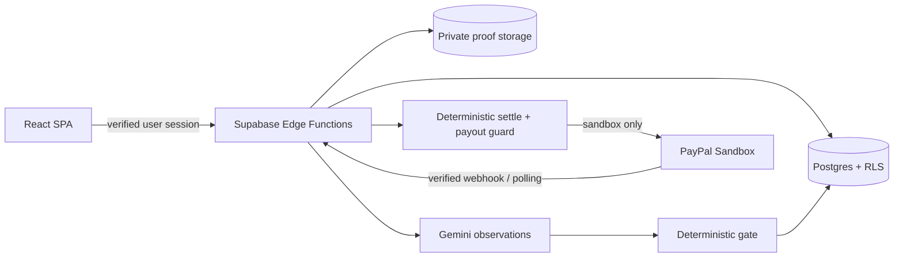

# BloomStake

> **Sandbox prototype — no real money.** PayPal is restricted to its sandbox host. The guided demo uses simulated stakes and does not call PayPal.

BloomStake makes a seven-day wellness goal visible and accountable. A user commits a stake to a pact, submits daily screenshot/photo evidence, and watches a garden respond to verified days. **Gemini only extracts observations; a deterministic gate decides the verdict, and a deterministic settlement engine plans every cent. AI never moves money.**

## Project status

Phases 1–9 are implemented, locally verified, and pushed. Phase 10's local delivery materials are included; hosted Supabase wiring, live PayPal sandbox acceptance, Cloudflare Pages deployment, screenshots, device checks, and submission still require owner-controlled accounts or devices. The app is not yet a live public demo.

| Capability                                             | Status                                                 |
| ------------------------------------------------------ | ------------------------------------------------------ |
| Rule Contract, evidence pipeline, garden, audit feed   | Implemented                                            |
| PayPal sandbox stake, payout, and refund flows         | Implemented; no sandbox acceptance run in this session |
| Deterministic payout guard and settlement receipt      | Implemented                                            |
| Guided demo with clearly labelled simulated peers/days | Implemented; migration is in `main`                    |
| Hosted deployment and public demo                      | Pending owner setup                                    |

## Safety and privacy

- Sandbox only. Functions reject non-sandbox PayPal hosts. Payment and settlement kill switches default off.
- Money amounts and recipients come from database rows and verified PayPal captures, never from the browser.
- The AI referee returns observations only. `gate()` makes proof decisions and `settle()` computes payouts.
- **Demo uses sandbox money. Do not upload personal photos. Images are processed by Google’s Gemini API under its free-tier terms, which may allow review and product improvement.** Browser-generated sample proofs avoid sending a personal image.
- Simulated demo stakes/days are labelled and never become PayPal payouts.
- A real launch would require payments/gambling-law review and PayPal policy approval.

## Architecture



## Stack

| Layer           | Technology                                                          |
| --------------- | ------------------------------------------------------------------- |
| Web             | React 19, Vite, React Router, TanStack Query, Tailwind CSS v4       |
| Garden          | Three.js + React Three Fiber procedural geometry, SVG fallback      |
| Backend         | Supabase Postgres/RLS, Auth, Storage, Realtime, Deno Edge Functions |
| Validation/core | TypeScript, Zod, property-tested deterministic rules                |
| AI              | Google Gemini model chain; observations are untrusted input         |
| Payments        | PayPal REST sandbox: Orders, Webhooks, Payouts, Refunds             |
| Tests           | Vitest, Testing Library, fast-check, Deno tests, pgTAP              |

## Repository layout

```text
apps/web/                 Vite SPA, route UI, browser tests
packages/core/            Pure shared rules, gate, settlement, schemas, dates
supabase/migrations/      Schema, RLS, functions, Phase 8/9 migrations
supabase/functions/       Authenticated Edge Functions and webhook handlers
supabase/tests/           pgTAP invariants and database acceptance checks
scripts/                  Core sync and Deno verification helpers
.github/workflows/        CI and secret-configured operations schedule
```

## Local development

Requirements: Node.js 24, Deno 2, and Docker (for the local Supabase stack).

```bash
npm ci
cp .env.example .env       # set only local/public web values; never commit .env
npm run dev
```

For Supabase functions and database tests:

```bash
supabase start
supabase migration up
supabase functions serve
npm run check:functions
npm run test:functions
supabase test db
```

The demo needs Supabase for guest sessions, but its four stakes are simulated and it makes no PayPal calls. Mia, Omar, and Zed have deterministic outcomes; simulated days call neither Gemini nor PayPal. The player's first proof still uses the configured proof referee. `/admin` exposes health and retry controls only when an operator enters the secret at runtime; the secret is never part of the frontend build.

The root `.env.example` documents variable names. Web `VITE_*` values are public build-time settings. PayPal/Gemini/admin/cron secrets belong in the local Supabase function environment or Supabase secrets, never in the repository. `VITE_PAYMENTS_ADAPTER=mock` and `PAYMENTS_ADAPTER=mock` are local-only; production builds/functions reject mock payments on hosted projects.

Quality checks:

```bash
npm run typecheck
npm test
npm run check:functions
npm run test:functions
npm run build
supabase test db
```

## Demo

Open `/demo`, start the guided demo, and open your pact in the garden. Submit the browser-generated sample proof first. Then use the fast-forward control: Mia’s remaining days pass; Omar’s and Zed’s miss. The simulated days are marked in the timeline and make no AI or money call. Clearing site data loses this guest demo garden.

The garden respects `prefers-reduced-motion`, supports a low-cost `?lite=1` renderer, and falls back to accessible SVG when WebGL is unavailable. Validate the target browsers and devices against the checklist before calling the hosted app accepted.

## Deployment status

Live app: https://stake-to-bloom.munaxa-tm.workers.dev (Cloudflare Workers static assets). Backend: a hosted Supabase project (Postgres, Auth, Storage, Edge Functions). Everything runs against the PayPal **sandbox**; no real money moves. Live sandbox checkout, payout and refund acceptance is recorded in [`docs/phase10-runbook.md`](docs/phase10-runbook.md). Never put private keys, passwords, buyer credentials, or webhook secrets in the repository.

The `keepalive.yml` workflow calls the hourly maintenance endpoint and daily health check after `SUPABASE_PROJECT_URL` and `CRON_SECRET` are configured in GitHub Actions. Without both secrets it reports a visible skip; that no-op does not count as live acceptance. The Phase 10 submission checklist and 2:45 recording outline are in `docs/`.

## Attribution and license

Design patterns (layout, tokens, Gemini-wrapper and rate-limit ideas) are informed by the author’s earlier [Health Garden project](https://github.com/Shahoud867/health-garden-app). BloomStake’s money, AI gate, and settlement code are written for this repository. The code in this repository was written after 1 Oct 2026.

MIT License — see [LICENSE](LICENSE).
