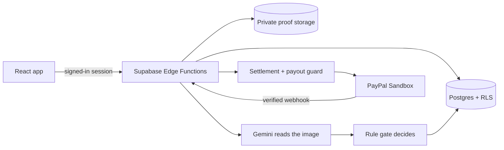

# BloomStake

**Stake it. Prove it. Grow it.**

BloomStake turns a seven-day wellness goal into a small commitment. You pick a goal (steps, water, a healthy meal, a workout, or your own), put a stake on it through PayPal, and upload a screenshot or photo as proof each day. A garden grows with every verified day and wilts when you miss. Keep your promise and your stake comes back; in a group, the stakes of people who miss are shared among those who showed up, and if nobody succeeds the money goes to charity.

- **Live app:** https://stake-to-bloom.munaxa-tm.workers.dev
- **90-second tour (no sign-up, no PayPal account needed):** open the live app, click **See how it works**, then **Start the demo**.
- **Code:** this repository, MIT licensed.
- **Everything runs on the PayPal Sandbox with test money.** No real money moves anywhere in this project.

## Why it exists

Good intentions fade. A small, visible commitment with something real on the line is a proven way to keep going, and a garden that visibly grows is a kinder reminder than a red number. BloomStake is a friendly commitment device: you choose the goal and the stake, the rules are locked before you pay, and nothing is taken by the platform.

## How to try it

### Option 1: the live demo (recommended)

1. Open the live app, click **See how it works**, then **Start the demo** (a guest session is created automatically).
2. Open **Try a generated sample proof** on the pact page and submit it. The proof is read and checked, and your plant starts to grow.
3. Press **Fast-forward one day** a few times. Simulated players Mia, Omar and Zed finish their pact, and you see the settlement receipt. Simulated stakes and days are labelled and never touch PayPal.
4. Open **Audit** to see the real PayPal order and capture IDs from sandbox payments.

### Option 2: stake with PayPal (sandbox)

1. Click **Start a pact**, choose a goal and review the rules, then lock them.
2. Click **Stake $20.00 with PayPal** and approve with a PayPal **sandbox buyer** account.
3. The pact becomes active and the plant is seeded.

Sandbox buyer logins for judges are provided privately in the Devpost testing instructions. They are intentionally not in this public repository.

## How PayPal is used

| PayPal API / feature                                  | What it does in BloomStake                                                                                                                        |
| ----------------------------------------------------- | ------------------------------------------------------------------------------------------------------------------------------------------------- |
| Orders v2 (create, get, capture)                      | The server creates the order from the pact's stored stake, the buyer approves in the PayPal JS SDK v6 checkout, and the server captures it.       |
| Webhooks + signature verification                     | Payment events are verified with PayPal's `verify-webhook-signature` before they can fund a pact. Replays are harmless no-ops.                    |
| Idempotency (`PayPal-Request-Id`, unique constraints) | Every create, capture, payout and refund uses a deterministic request id, so a retry can never charge or pay twice.                              |
| Payouts                                               | When a pact settles, winners are paid in a single guarded payout batch. The plan is stored before any money moves.                               |
| Refunds                                               | Cancelling before day one, and refunding a payment that arrives after a pact expired, use the Refunds API.                                        |

**What is verified live in the sandbox:** Orders create and capture, webhook signature verification, and the audit feed with real IDs. **Implemented and covered by automated tests with a mock PayPal client, but not yet exercised live:** Payouts and Refunds.

Safety rules the code enforces: PayPal is restricted to the sandbox host; the amount and recipient always come from database rows and verified captures, never from the browser; money functions return 503 when their kill switch is off.

## How AI is used

Google Gemini reads each proof image and reports what it sees: the date, the number on screen, and whether a required code is visible. That output is treated as untrusted data. A deterministic rule gate compares it with the rules the user locked when they staked, and a separate settlement engine computes every payout. The AI has no tools and no access to money.

Other AI uses: for custom goals, the AI drafts a rule that the user must read and confirm before anything is locked.

Guardrails: prompt-injection text in an image is flagged and rejected, repeated images are refused, attempts are capped per day, and a model fallback list copes with model changes.

## Built with

React 19, TypeScript, Vite, Tailwind CSS, TanStack Query, Supabase (Postgres with row-level security, Auth, Storage, Deno Edge Functions), Zod, Google Gemini API, PayPal Sandbox (Orders, Webhooks, Payouts, Refunds, JS SDK v6), Cloudflare Workers, GitHub Actions, Vitest, Deno tests and pgTAP.

No other sponsor integrations are used.

## Architecture



## Run it yourself

Requirements: Node.js 24, Deno 2, Docker, and the Supabase CLI.

```bash
git clone https://github.com/munazat/Stake-To-Bloom.git
cd Stake-To-Bloom
npm ci
supabase start                 # local Postgres, Auth, Storage (Docker)
supabase db reset              # applies every migration
```

Create `.env` from `.env.example` and set:

```bash
VITE_SUPABASE_URL=http://127.0.0.1:54321
VITE_SUPABASE_ANON_KEY=<anon key printed by `supabase status`>
VITE_PAYMENTS_ADAPTER=mock     # local only: stands in for PayPal
```

Create `supabase/functions/.env` (never commit it) with at least:

```bash
GEMINI_API_KEY=<your key>
PAYMENTS_ADAPTER=mock          # local only; hosted projects refuse the mock
```

To use the real PayPal sandbox instead of the mock, add `PAYPAL_ENV=sandbox`, `PAYPAL_CLIENT_ID`, `PAYPAL_CLIENT_SECRET` and `PAYPAL_WEBHOOK_ID`, and set `VITE_PAYPAL_CLIENT_ID` in `.env`.

```bash
supabase functions serve       # in one terminal
npm run dev                    # in another, then open http://localhost:5173
```

The guided demo works with the local stack and a Gemini key. Payments are off by default; the `payments_enabled` switch lives in the `app_config` table.

Quality checks:

```bash
npm run typecheck
npm test
npm run check:functions
npm run test:functions
npm run build
supabase test db
```

## Repository layout

```text
apps/web/                 React app and browser tests
packages/core/            Pure shared rules: rule gate, settlement, schemas, dates
supabase/migrations/      Schema, row-level security, functions
supabase/functions/       Edge Functions and the PayPal webhook handler
supabase/tests/           pgTAP database tests
scripts/                  Helpers, including the PayPal sandbox smoke test
.github/workflows/        CI and the keep-alive/health schedule
docs/                     Runbook and submission notes
```

## Privacy

Proof images are sent to Google's Gemini API for reading, under its free-tier terms, which may allow review and product improvement. Please do not upload personal photos. The in-app sample proofs are generated in the browser so no personal image is needed. A real launch would need payments-law review and PayPal policy approval.

## Attribution and license

Garden field artwork and some design patterns come from the author's earlier [Health Garden](https://github.com/Shahoud867/health-garden-app) project. All code in this repository, including the money, rules, AI gate and settlement code, was written for this hackathon after 1 October 2026.

MIT License. See [LICENSE](LICENSE).
